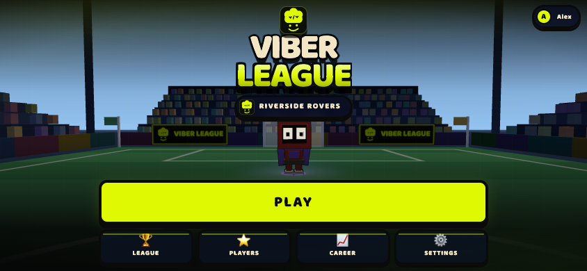
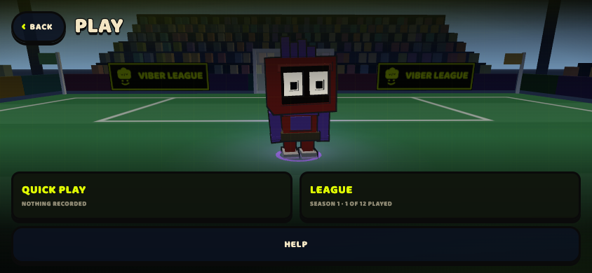
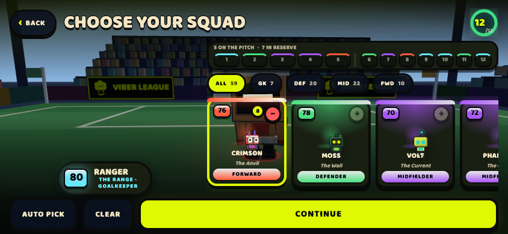
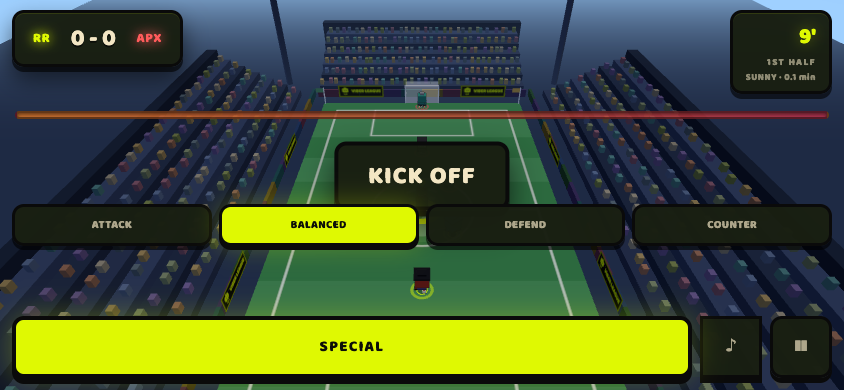
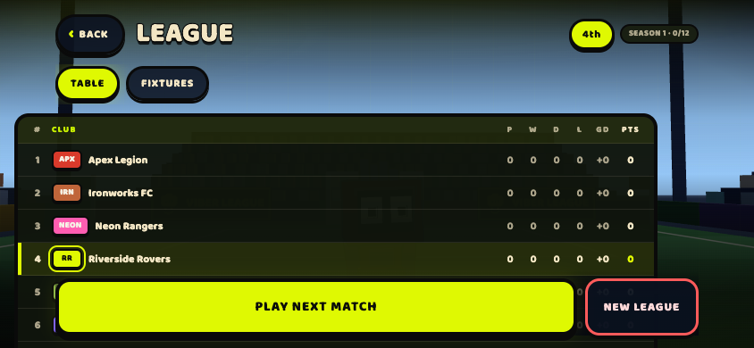
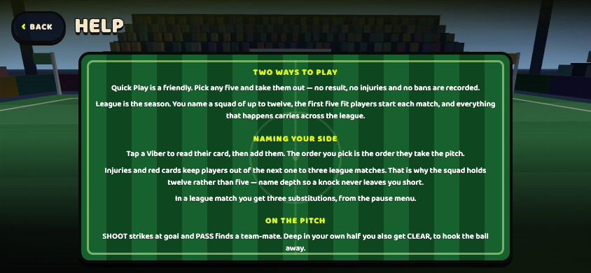

# Viber League

[](https://github.com/kforc/Viber-League/actions/workflows/ci.yml)

A mobile-first arcade football club game. **It ships as one self-contained HTML
file** — no external assets of any kind. Every crest, every Viber and every
referee's whistle is generated in code, and the single display font is inlined as
a data URI. There are no network calls at runtime.

**▶ Play it:** a live `*.github.io` link is created automatically on push by the [GitHub Pages workflow](#c-githubio-via-github-pages-no-account-needed). Prefer Cloudflare? The [Deploy](#deploy) section also covers a `*.workers.dev` / `*.pages.dev` link. The old `agentos-app.run` host could not stream the 772 kB bundle reliably and has been retired.

Nothing to install — it runs in the browser and works on a phone.

For a copy with nothing added to it, download
[`Viber-League.html`](Viber-League.html) and open that instead.

<p align="center">
  
  
</p>
<p align="center">
  
  
</p>
<p align="center">
  
  
</p>

---

## Deploy

The game is one self-contained HTML file plus six PNGs (used for the
social-preview card), so any static host will serve it. The recommended
home is **Cloudflare's free tier** — the edge delivers a 772 kB file in
well under a second, and the `*.workers.dev` URL is permanent.

Two routes, both starting from this repo:

### A. `*.workers.dev` with the Wrangler CLI

This is the "real" deploy — a Worker serves the static assets from
Cloudflare's edge. The `wrangler.toml` and `worker.js` at the root of
this repo are set up for it.

```bash
# 1. Install wrangler (once, on your machine)
npm install --save-dev wrangler

# 2. Link this machine to your Cloudflare account
npx wrangler login

# 3. Build the deploy directory and push it
npm run deploy:cf
```

`npm run deploy:cf` runs `prepare:site` (which copies
`Viber-League.html` to `site/index.html` and the PNGs to
`site/docs/media/`) and then `wrangler deploy`. The output ends with a
URL of the form

```
https://viber-league.<your-account-subdomain>.workers.dev
```

Open it once to confirm the game loads, then paste the URL into the
"Play it" line near the top of this README. (If wrangler reports it
created a `workers.dev` subdomain for your account on the first
deploy, that is the one to use — you can rename the project later
under Workers → Settings.)

### B. `*.pages.dev` via the Cloudflare dashboard (no CLI)

If you would rather not install anything:

1. Sign in at <https://dash.cloudflare.com/>, then **Workers & Pages →
   Create → Pages → Upload assets**.
2. Project name: `viber-league`.
3. Run `npm run prepare:site` once, then upload the resulting `site/`
   directory (drag the whole folder onto the page).
4. Click **Deploy site**. Cloudflare prints a `*.pages.dev` URL.

### C. `*.github.io` via GitHub Pages (no account needed)

Because the code already lives on GitHub, the simplest link is one GitHub
makes for you — no Cloudflare sign-up, no wrangler, no token. A
[`deploy-pages.yml`](.github/workflows/deploy-pages.yml) workflow runs
`npm run build` (the Vite `dist/` production build) and publishes it on every
push to `main` via `actions/deploy-pages`. The first run enables Pages with
"GitHub Actions" as the source automatically. `vite.config.ts` uses
`base: './'` so the built assets resolve correctly under the `/viber-league/`
subpath.

The link takes the form:

```
https://kforc.github.io/viber-league/
```

(gitHub lowercases the repository name). Confirm the game loads, then paste
it into the "Play it" line at the top of this README.

### Why not the old link?

The `agentos-app.run` link that lived here through mid-October 2026 was
a preview; its edge could not stream the 772 kB bundle reliably
(headers arrived, then the body stalled), which produced the
blank-page symptom. Cloudflare does not have that problem.

---

## Quick start

```bash
npm install
npm run dev        # http://localhost:5173
```

Then open the URL on a phone-sized viewport and tap **START GAME**.

Other scripts:

```bash
npm run build      # type-check + production build to dist/
npm run bundle     # build, then inline everything into Viber-League.html
npm run preview    # serve the production build
npm test           # simulation test suite (determinism + balance + flow)
```

Dev hooks: append `?autostart` to skip the title screen and drop straight into a
match, and `?seed=<n>` to pin it to one.

---

## Verify the build

The shipped file is not a black box you have to take on trust. It builds
reproducibly, so you can rebuild it from this source and check it yourself:

```bash
npm ci
npm run bundle
shasum -a 256 Viber-League.html
```

```
3314177b33276c5bf597ca6d032871009e0d7c875468095c632c5ab4c4fc6efa
```

That is the SHA-256 of the committed `Viber-League.html` — 772 kB, byte for byte.
CI runs the same thing on every push and **fails if a fresh build stops matching**,
so the claim cannot quietly rot.

There is no server, no network call and no external asset in that file. The
bundler fails the build if one appears.

**The served page is byte-identical to the file.** On Cloudflare (the
host the [Deploy](#deploy) section sets up) the edge serves the
committed `Viber-League.html` as-is — no beacon, no injection, no
modification. The earlier `agentos-app.run` preview host appended a
small analytics tag and has been retired; that is why the page at *its*
URL was *not* the same bytes. On Cloudflare it is.

---

## The two modes

Everything begins at **PLAY**, which asks which kind of game you want.

- **Quick Play** is a friendly. Pick any five from the whole roster, choose a
  venue and a length, and go. No result, no injury and no ban is recorded — it is
  isolated by construction rather than by a scatter of guards: it draws from its
  own selection, carries no bench, and every career write is gated on it.
- **League** is the season. You name a squad of up to twelve, and everything that
  happens carries across the table, the fixture list and your career history.

A mode is a *lens* over one pre-match flow, not a second flow. The squad screen,
AUTO PICK, the pick toggle and `starters()` all read the current selection through
a single accessor, so there is exactly one place that knows the two are different.

### What's playable

**Create a club → Title → PLAY → Quick Play or League → Choose your five →
Venue → Match length → Opponent → Kick off**

- **Create your club first.** A new player picks a manager name, a club name and
  one of six crests, and sets a password so the club can be got back. The password
  is never stored — PBKDF2-SHA256 with a random per-profile salt, and only the
  derived hash is kept.
- **The crest you pick is the crest you get.** The same vector mark is worn by the
  title screen, the account sheet, the scoreboard and the pitch, because all four
  read it from one definition in `brand.ts`.
- **59 Viber characters** (matching the reference art), each with a football-card
  profile: six attributes, an overall rating, an archetype and a team SPECIAL.
- **Tap any Viber to inspect their qualities** — a card with attribute bars,
  overall badge and special ability, then add them to your squad. The order you
  pick is the order they take the pitch.
- **Weather matters.** Sunny, Rainy, Icy and Cold each change ball friction,
  acceleration, turn rate, top speed and shot accuracy — and repaint the pitch.
- **Match length**: 2 / 3 / 5 minute matches.
- **The opponent is chosen automatically** from your squad's overall rating, so
  every match is an even fight. It is composed by position (1 GK, 1 DEF, 2 MID,
  1 FWD) and drawn from a club pool that scales with difficulty.
- **AI plays the game for you** — you don't move players with a joystick. You make
  the decisions (spec §5.2): Attack / Balanced / Defend / Counter, contextual
  **Shoot / Pass / Clear** prompts, and a team **SPECIAL** — a six-second burst of
  pace for the whole five, on a twenty-two second cooldown.
- **It plays like football, not pinball.** The pitch has real boundaries, so the
  ball goes out: **throw-ins, corners, goal kicks and free kicks** are all
  awarded, positioned and taken. Wingers hold the touchline and drive at the
  byline to **cross**; shots are blocked and **deflected behind for corners**;
  keepers dive (one dive per shot) and either hold, tip behind, or get beaten; and
  a mistimed tackle in the box concedes a **penalty**.
- **Two halves** with a half-time tactical choice, goal celebrations with
  confetti, pause, and a full-time results screen with match stats (possession,
  shots, passes, corners, fouls, tackles).
- **Mobile-first UI** — portrait and landscape, touch-sized targets, safe-area
  aware.

### The league

- **Seven clubs, twelve matches each.** Your club plus six opponents — Rookie
  Rovers, Neon Rangers, Ironworks FC, Vortex Athletic, Titan United and Apex
  Legion — in a round-robin of fourteen matchdays. With an odd number of clubs
  someone rests each round, and the circle method hands the player the first one.
- **Nobody gets ahead of you.** The other clubs' results are *derived* from the
  season seed rather than stored, and they are only revealed once you have played
  that matchday yourself. The table never runs ahead of the player.
- **Twelve players, five shirts.** The first five fit players start; the rest are
  cover. An injury keeps a Viber out of the next one to three league matches and a
  red card one to two, which is the whole reason the squad holds twelve rather than
  five.
- **Three substitutions** from the pause menu, drawn from the fit players not
  already on the pitch.
- **A league gate.** Because a save written before leagues existed still has a
  season, injuries and a table, LEAGUE offers **New League** or **Load Existing
  League** rather than wiping that progress.
- **Finish all twelve** and the season is filed into your career history.
- **Help is in the game** — a guide laid out on a pitch, and every line in it is
  checked against `sim/` rather than written from what a football game is usually
  like.

### The roster

**59 Vibers** across four roles, each with distinct attributes and a signature
design (head-top slab, face treatment, eyes and colour). Examples:

| Viber | Role | Archetype | Identity |
|---|---|---|---|
| **Frost** | GK | Keeper | The Glacier — safe hands between the posts |
| **Moss** | DEF | Defensive | The Wall — a rock that reads the game |
| **Crimson** | FWD | Power | The Anvil — heavy, wins the ball, bullies the box |
| **Volt** | MID | Speed | The Current — pure acceleration, breakaways |
| **Phantom** | MID | Trickster | The Ghost — creates from nothing |
| **Cobalt** | MID | Playmaker | The Captain — pings passes nobody else sees |
| **Beacon** | MID | Playmaker | The Signal Tower — the periscope head |
| **Warden** | DEF | Anchor | The Curfew — black cap, green visor |
| **Periscope** | MID | Engine | The Up Periscope — cross-eyed cyan optics |
| **Icicle** | FWD | Striker | The Cold Snap — ice-blue, gold boots |
| **Moose** | FWD | Target Man | The Antlers — wins every header |

Teams are told apart by a **team-coloured ground ring** and a **kit stripe**,
while each Viber keeps their own head/body colours — so both "which team?" and
"which Viber?" read at a glance from the high camera.

---

## Architecture

Three layers with one hard rule, enforced by the file layout:

```
sim/     pure, deterministic simulation  ── never imports three.js or the DOM
render/  Three.js presentation           ── reads sim state, never writes to it
ui/      menus, HUD, screens             ── presentation only
audio/   synthesized match sound         ── driven by the sim's event stream
brand.ts the mark and the crest set      ── pure geometry, consumed by BOTH ui/ and render/
app/     the ONLY place these meet
```

`brand.ts` sits at the root beside `sim/` rather than inside `ui/` or `render/`
because both of them need it and neither is allowed to import the other. It is
data and geometry, not presentation: the SVG path strings *are* the artwork.

### The simulation is the product

A match result here is not a number a server reports — it is a **replay**. The
simulation is seeded and fully deterministic, so anyone can re-run the same
fixture and confirm the same score. That property is what the whole architecture
is built around, and it is what makes a result *verifiable* rather than merely
*trustworthy*.

- **Fixed 60 Hz timestep.** The sim never sees a variable `dt`.
- **Seeded PRNG only** — there is no `Math.random()`, `Date.now()` or
  `performance.now()` anywhere in `sim/`.
- **Replayable.** Same seed + same inputs ⇒ identical event log. The test suite
  asserts this.
- **Custom 2.5D ball physics** and kinematic steering — no general physics engine,
  because determinism and mobile weight both matter more than realism.

This boundary is what makes replay and headless testing possible without a
redesign, and it is why the CDP harnesses can step a whole match in a headless
browser that has no compositor and runs animation frames at roughly 5 fps.

### Rendering

- Three.js, **flat-shaded (Lambert)** chunky low-poly characters built
  **procedurally from data** (`roster.ts` drives head-top, face treatment,
  colours, accessories) with **uniform-thickness inverted-hull black outlines**
  (the Viber Brawl look).
- **One giant box head (~1.7× the torso width), a flat overhanging head-top slab,
  and glowing eyes** — matching the supplied reference art.
- Four face treatments drive most of the personality: `cubes` (bare eyes on the
  head), `panel` (coloured plate, big white eyes), `plate` (black plate, small
  glowing eyes) and `bar` (single glowing bar).
- Pitch markings baked into a canvas texture (free at runtime); the texture swaps
  between grass and snow for icy conditions.
- Per-weather **fog** softens the far end of the pitch and hides the edge of the
  world; rain and snow are a single recycled `THREE.Points` cloud (cheap on
  mobile).
- Blob shadows instead of shadow maps (mobile budget).
- Camera sits behind the player's own goal so **you attack away from the viewer**.
  On a goal it pushes in toward the goal end (height and distance eased at
  12%/frame, so the whip-in never reads as a glitch) and pulls back out before the
  restart. The push-in is aspect-aware: a portrait viewport is narrow, so the same
  move that frames the group in landscape would crop the near Vibers out of shot,
  and the camera holds further back there.

### The brand

The official mark — a lime chef-hat head with a V/V, two eyes and a smile on a
near-black rounded square — lives in `src/brand.ts` as **pure geometry**. The
large lime eyes sit below the head, on the ink badge, and preserve the original
mark's slight tilt; they are not ink cut-outs. There is exactly **one** definition
of the mark. The same SVG path strings are used by both renderers: the DOM gets
`<path d="…">` markup, the canvas gets `new Path2D(d)` on those identical strings.

- **Why not an image file.** The shipped game is one self-contained HTML file and
  the inliner fails the build on any external reference. A data-URI PNG would pass
  that check but bloat the bundle and lose its edge at every size.
- **Six club crests** come from the same module (`viber`, `ball`, `bolt`, `star`,
  `crown`, `shield`), which is what makes the crest a player picks in the
  onboarding form the same crest the title screen, the account sheet and the pitch
  all wear.
- **On the pitch**, the mark is mown into the centre circle in two grass tones —
  white paint with a darker green cut-out, inverted on snow. It is painted on its
  own canvas and composited at low alpha, because the face is made of *cut-outs*:
  painted straight onto the turf the near-black ink would land as a smudge.
- **Around the pitch**, the ground carries its own hoardings: a black plate with a
  lime rule, the mark, and an auto-fitted `VIBER LEAGUE` wordmark. They stand on
  both touchlines and either side of the far goal.
- The board face is repainted once `document.fonts.ready` resolves. The display
  face ships as a data-URI `@font-face`, which still loads asynchronously, and a
  board whose wordmark silently fell back to a system sans would be the one piece
  of signage that does not look like us.

### Sound

Every sound is **synthesized at runtime** from Web Audio primitives — there is no
audio file anywhere in the project, because the shipped build is a single
self-contained HTML file with no external references at all.

- The referee's whistle is band-passed noise (air through the slot) plus a
  near-sine at ~2.1 kHz and its octave (the tone) plus a 36 Hz amplitude trill
  (the pea). `WHISTLE_SCHEDULE` in `audio/sound.ts` holds the **shape** per kind of
  stoppage: one blast to start play, two for a foul and for half time, one long one
  to end the match.
- The crowd is two readers of one pink-noise buffer — one low-passed into a
  rumble, one band-passed into the hiss — with a slow wobble so it breathes.
  Excitement drives the gain **and** both filter cutoffs: an excited crowd is
  brighter, not merely louder.
- A goal is three noise bands arriving at different speeds, so it reads as people
  rather than as static.
- `CrowdHeat` is the pure part: event jolts (`excite`) plus a decay, weighted so
  the ball's position can never reach the level a goal does.
- Nothing is built until `unlock()` is called from the KICK OFF tap, and a muted
  game **never constructs an `AudioContext` at all**.

---

## Project structure

```
src/
  sim/          engine, ai, physics, world, setpiece, league, roster, weather,
                content, constants, types (pure) + core/ (math, rng)
  render/       renderer, characters, pitch, stadium, showcase
  ui/           hud, screens, avatar, dom helpers
  audio/        sound (synthesized whistle, crowd, goal, kick, save)
  brand.ts      the official mark + the six club crests, as pure SVG geometry
  app/          game.ts (wiring + flow state machine), career.ts, profile.ts
  main.ts       entry point
tests/
  sim/          determinism, balance, league, set pieces, subs, discipline, tactics
  app/          career + profile persistence
  audio/        whistle patterns + crowd model + no-Web-Audio fallback
  render/       celebration poses + the goal-phase clock that drives them
  brand.test.ts path helpers, the icon set, and that the markup is safe for innerHTML
tools/cdp/      headless-Chrome harnesses, the single-file bundler, contact sheets
docs/           the technical plan, and the handful of screenshots the README uses
```

### Dead-ball phases

`sim/setpiece.ts` owns everything that happens when the ball is not in play.
`physics.integrateBall` reports *that* the ball left the field (touchline or goal
line); `setpiece.awardFromOutOfPlay` decides *what* that means:

| Situation | Restart |
|---|---|
| Over the touchline | Throw-in to the side that did not put it out |
| Over the goal line, last touch by the defending side | **Corner** |
| Over the goal line, last touch by the attacking side | Goal kick |
| Failed tackle inside the offender's own box | **Penalty** |
| Failed tackle anywhere else | Free kick |

Each restart is a real phase (`w.phase` equals the set-piece kind) with its own
timer. Corners and penalties **snap everyone to their station** — there is no time
for attackers to run 30 metres upfield, so the box is packed immediately. Every
other restart lets players walk. When the timer expires `runSetPiece` strikes the
ball and hands play back to the AI.

The **clock runs through dead balls too**, so the chosen match length is exact, and
a restart left pending when the clock expires cannot resurrect the match.

On a penalty the shot travels through the sim rather than being decided by an
instant score roll: the taker picks the placement before the kick and the keeper's
dive is resolved inside `takePenalty`, so nobody can watch the keeper and then
choose.

---

## Tuning

Almost everything that defines the feel lives in:

- `src/sim/constants.ts` — pitch size, ball physics, shot range, set-piece pauses,
  the penalty area, foul chances, special ability, injury and ban lengths.
- `src/sim/roster.ts` — the 59 Vibers: attributes, roles, specials, designs, and
  the auto-opponent matching logic.
- `src/sim/weather.ts` — per-condition gameplay multipliers and visuals.
- `src/sim/setpiece.ts` — restart stations, who takes what, and how each is played.
- `src/sim/league.ts` — the round-robin schedule and the derived results.
- `src/sim/content.ts` — formations and the opponent club pool.
- `src/app/career.ts` — squad size (5), league squad cap (12) and bench size (3).

Current balance: matches are **deterministic** (same seed ⇒ identical result), the
auto-opponent lands within a few rating points of your squad, and mirrored squads
show **no structural home advantage** — the test runs eight seeds and asserts the
two sides land inside a band derived from the total goals scored, so it catches a
real drift without failing on noise.

Two things drive results more than anything else, and `overallOf` is weighted to
match: **pace** (winning loose balls and breakaways) and **strength/technique**
(shielding the ball and surviving challenges). Shooting affects power *and*
accuracy — a weak finisher sprays shots.

A typical 3-minute match produces roughly **4 goals, 27 shots, 4 corners, 5 fouls
and 4 free kicks**. Those figures are measured rather than estimated — the
set-piece suite plays six full matches and prints the totals it asserts on.

If you want calmer or wilder games, tune `SHOT_SPEED`, `SHOOT_RANGE`,
`KEEPER_SAVE_REACH` and `FOUL_CHANCE_BOX` in `src/sim/constants.ts`. The keeper's
**one dive per shot** (`Ball.saveCooldown`) is what stops them covering the whole
goal; widen `KEEPER_SAVE_REACH` for more saves, narrow it for more goals.

---

## How it is checked

```bash
npm test                       # 242 tests across 12 files
npm run bundle                 # also asserts the bundle has no external references
npm run shots                  # the full flow in headless Chrome, landscape
npm run shots:portrait         # the same flow at 390×844
```

The harness in `tools/cdp/flow-club.mjs` walks the entire game — club creation,
both modes, the league gate, the squad picker, a match driven to full time, the
result screen and a reload — and asserts on the DOM at each step. It steps the sim
directly rather than waiting on animation frames, because a headless browser has
no compositor.

A few habits that have paid off, and are worth keeping:

- **Look at the screenshots.** A raw `0.0666min` clock, a smudged centre-circle
  emblem, a hoarding hidden behind the goal net and an invisible mown stripe were
  all caught by reading the rendered PNG, never by an assertion.
- **Measure, don't assert.** Text contrast is settled by computing WCAG luminance
  from the composited pixels, not from the declared colours.
- **A check that passes on the wrong screen is worse than no check.** One harness
  drove a match to "full time" and asserted a selector that also matches the
  half-time panel; it went green while the match was still in the first half.
- **A check can require the bug.** Another asserted that PLAY NEXT MATCH was
  disabled on a fresh league — pinning the exact dead end a player then reported.

---

## Status

| Milestone | Status |
|---|---|
| M0 App shell + identity | ✅ |
| M1 Vibers in football context | ✅ (59-Viber roster + card profiles) |
| M2 Pitch + ball physics + deterministic loop | ✅ |
| M3 AI players + formations | ✅ |
| M4 Tactical controls | ✅ |
| M5 Complete playable match — the fun gate | ✅ |
| M6 Goal presentation / pause / results | ✅ |
| M6.5 Pre-match flow: squad select, weather, length, auto opponent | ✅ |
| M6.6 Set pieces: corners, throw-ins, goal kicks, free kicks, penalties | ✅ |
| M7 Club, squad, career history | ✅ |
| M8 League season: 7 clubs, fixtures, table, injuries and bans | ✅ |
| M9 Quick Play / League modes, in-game guide | ✅ |
| M10 Academy, transfers | ⛔ not started |

---

## License

[MIT](LICENSE). The artwork is not a separate asset set — it is SVG path strings
and procedural geometry in `src/brand.ts` and `src/render/`, so it is covered by
the same licence as the code.
